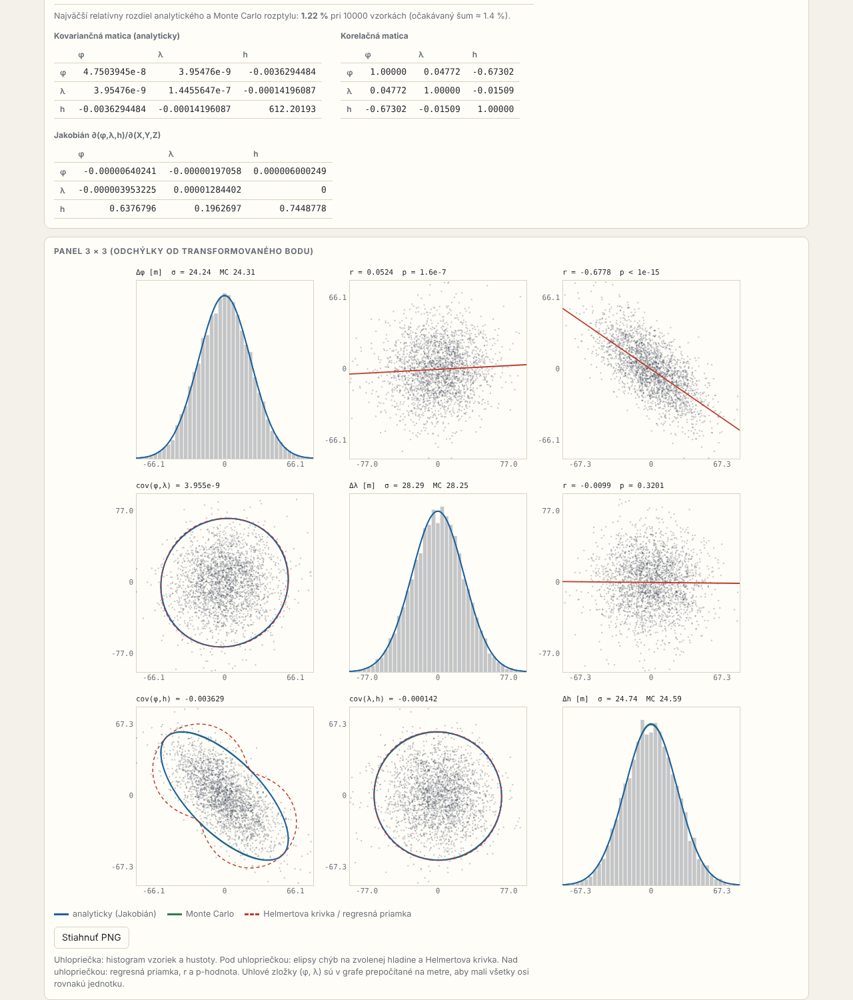
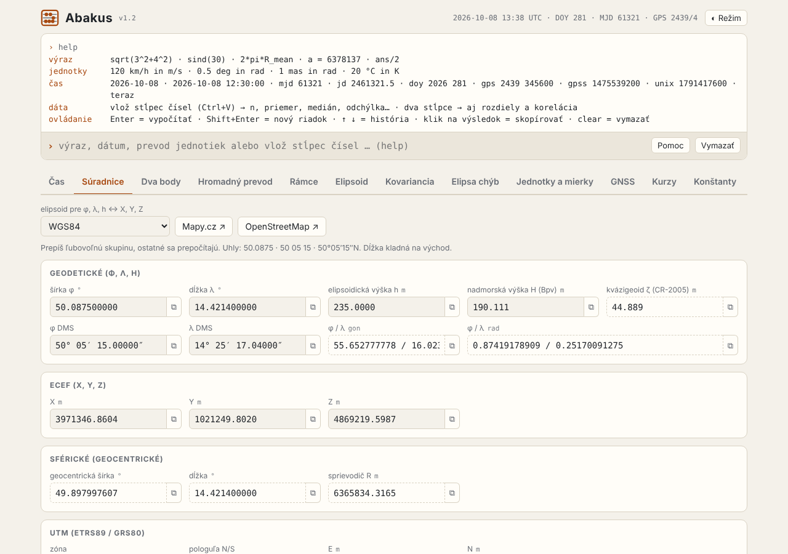

# Abakus

Kalkulačka prepočtov pre geodéziu a GNSS: čas, súradnice, geodetické úlohy, kovariancie, jednotky a rýchly príkazový riadok.
Celá apka je jeden súbor `abakus.html`. Beží v prehliadači na Windows aj Linuxe, bez inštalácie a bez knižníc.

Verzia 1.2 · október 2026



## Čo vie

| Časť | Obsah |
|---|---|
| Príkazový riadok | výrazy, premenné, `ans`, prevody jednotiek, časové príkazy, kvantily rozdelení. Vložený stĺpec čísel dá štatistiku a grafy, dva stĺpce aj rozdiely a koreláciu |
| Čas | UTC ↔ MJD ↔ JD ↔ rok + DOY ↔ GPS týždeň + SOW ↔ GPS sekundy ↔ Unix; GPST, TAI, priestupné sekundy |
| Súradnice | φ λ h ↔ ECEF ↔ UTM ↔ S-JTSK ↔ Web Mercator; výška h ↔ Bpv; LAEA, LCC |
| Dva body | Vincenty, ortodróma, loxodróma, priestorová spojnica, ENU, azimut a elevácia (aj prijímač → družica), priama úloha |
| Hromadný prevod | zoznam bodov medzi φ λ h, ECEF, UTM, S-JTSK + Bpv, ENU; export CSV |
| Rámce | ITRF2020 / 2014 / 2008 ↔ ETRF2000 / 2014 / 2020 so zadanou epochou |
| Elipsoid | konštanty 5 elipsoidov, polomery krivosti, oblúk poludníka, normálne tiažové zrýchlenie |
| Kovariancia | prenos matice 3×3 medzi ECEF, GEOD, ENU, SPHERE; kontrola Monte Carlo; panel 3×3 s elipsami chýb a Helmertovou krivkou |
| Elipsa chýb | poloosi, natočenie, hladina spoľahlivosti, Helmertova krivka |
| Jednotky a mierky | dĺžka, rýchlosť, uhol, čas, plocha, tlak, teplota; mierka mapy; decibely |
| GNSS | frekvencie a vlnové dĺžky signálov, wide-lane, narrow-lane, iono-free koeficienty |
| Kurzy | kurzový lístok ČNB, prepočet medzi menami |
| Konštanty | c, GM, ω, elipsoidy, ρ″; názvy fungujú aj v príkazovom riadku |



Grafy sa dajú stiahnuť ako PNG. Podrobný návod je v [MANUAL.md](MANUAL.md).

## Spustenie

**Najrýchlejšie:** dvojklik na `abakus.html`.

**S ikonou na ploche** (Python 3, len štandardná knižnica):

```
python vytvor_odkaz.py
```

Ikona spustí `abakus.pyw`: malý server na `http://127.0.0.1:8770/`, ktorý podáva `abakus.html` a sťahuje kurzy ČNB. Bez ikony: `abakus.bat` alebo `./abakus.sh`.

Server je potrebný len kvôli kurzom. Všetko ostatné funguje aj z holého súboru a bez internetu.

## Štruktúra

```
abakus.html          hotová apka (zložená zo src/)
abakus.pyw           spúšťač a server (port 8770, /api/kurzy, /api/ping, /api/vypnut)
vytvor_odkaz.py      ikona na ploche (Windows), spúšťač v menu (Linux)
abakus.bat, .sh      spustenie bez ikony
abakus.ico, .png     ikona
MANUAL.md            návod na používanie
build.py             zloží src/ do abakus.html
src/
  index.html         kostra stránky
  style.css          vzhľad, svetlý a tmavý režim
  grids.js           mriežky ČÚZK (opravná tabuľka S-JTSK, kvázigeoid CR-2005)
  core.js            výpočty, bez väzby na stránku (dá sa načítať v Node)
  ui.js              príkazový riadok a karty
tests/
  test_core.js       čas, súradnice, zobrazenia, Vincenty, štatistika, príkazový riadok
  test_cuzk.js       S-JTSK s tabuľkou, výšky Bpv, ITRF ↔ ETRF
  ref.json, ref2.json     referenčné hodnoty z PROJ
  make_ref.py, make_ref_cuzk.py   skripty, ktoré referenčné hodnoty vyrobili
docs/                obrázky do tohto README
```

## Úprava a zostavenie

1. Uprav súbory v `src/`.
2. `python build.py` zloží nový `abakus.html`.
3. Pri zmene `abakus.pyw` zvýš `VERZIA` v `abakus.pyw` aj v `src/ui.js` na rovnakú hodnotu. Ikona potom sama nahradí bežiaci starý server.

## Testy

Potrebný je Node.js (bez balíkov):

```
cd tests
node test_core.js      # posledný riadok: ALL OK
node test_cuzk.js      # rozdiely voči PROJ v mm
```

Referenčné hodnoty sú uložené v `ref.json` a `ref2.json`, PROJ na beh testov netreba.
Nové referencie vyrobia `make_ref.py` a `make_ref_cuzk.py`. Tie potrebujú `pyproj` a mriežky `cz_cuzk_*.tif` v dátovom priečinku PROJ.

## Presnosť

Overené proti PROJ 9.8:

| Vec | Zhoda |
|---|---|
| ECEF, UTM, Křovák, LAEA, LCC, Web Mercator | pod 1 mm |
| Vincenty | pod 1 mm, azimut 1e-7° |
| S-JTSK s tabuľkou ČÚZK, 40 bodov v ČR | 0,001 mm tam, 0,024 mm späť |
| Výška Bpv (CR-2005) | 0,002 mm |
| ITRF ↔ ETRF, 9 dvojíc rámcov, 3 epochy | pod 0,001 mm |

Zhoda s PROJ nie je presnosť v teréne:

- **S-JTSK v ČR:** niekoľko cm (EPSG uvádza 3,5 cm), výška Bpv asi 5 cm.
- **S-JTSK mimo ČR:** bez tabuľky, Helmert s presnosťou okolo 1 m. Apka to oznámi.
- **ETRS89 a WGS84** sa na karte Súradnice berú ako totožné. Rozdiel rieši karta Rámce.
- **Priestupné sekundy:** tabuľka končí záznamom 2017-01-01 (TAI − UTC = 37 s). Novú sekundu treba doplniť do `LEAPS` v `src/core.js`.
- **Jakobián** na karte Kovariancia sa počíta numericky centrálnymi diferenciami.

## Zdroje dát

- **Opravná tabuľka S-JTSK** `table_-y-x_3_v1710` a **kvázigeoid CR-2005**: © ČÚZK, licencia [CC BY 4.0](https://creativecommons.org/licenses/by/4.0/), prevzaté z [PROJ-data](https://github.com/OSGeo/PROJ-data/tree/master/cz_cuzk). Sú vložené v `src/grids.js`, preto má `abakus.html` asi 0,5 MB.
- **Parametre transformácií** (S-JTSK, ITRF ↔ ETRF): databáza EPSG cez PROJ.
- **Kurzy:** denný kurzový lístok ČNB.

## Súvisiace

Rozloženie panelu 3×3 na karte Kovariancia a zoznam elipsoidov vychádzajú z modulu `loki_geodesy` knižnice LOKI.
